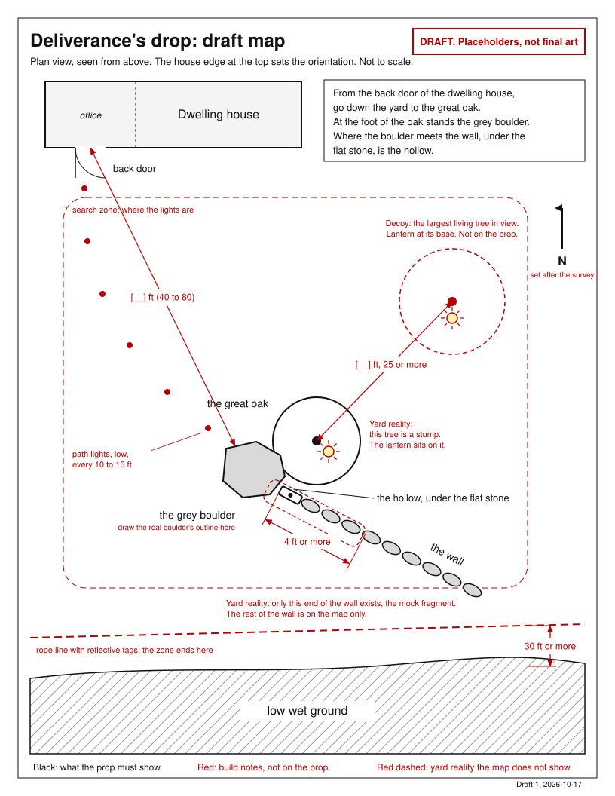

# Ashby backyard puzzle: Deliverance's drop, designed end to end

Scout report, 2026-10-17. Scope: Scene 4 of the Ashby Halloween escape room, from the map interpretation at the séance table to the letter's return, with the draft map, the cache build, the hint ladder, night and safety, the grave marker recommendation, and a placeholder sheet for the yard.

Everything here fits the design record of 2026-10-17 and the captain's rulings since. Facts carry a reference to the record in brackets. Where I had to choose, the text says "interpretation" and the open questions at the end collect the choices that are the captain's.

Files in this directory:

- `report.md`, this file.
- `map-draft.svg`, the draft map, printable at US Letter.
- `map-draft.png`, the same map rendered at 2x for phone viewing.

## 1. The scene, as the participants live it

The map lies open on the séance table. Through it Tamari has just reached Waitstill on his last errand, and the participants have told Constance that her son went out to the hiding place and never came back. She did not know. Now she looks at the map, and she knows the land on it.

She tells them what it shows. The yard behind the house runs down to a great oak. At its foot stands the grey boulder. From the boulder a stone wall runs away toward the low wet ground. Where the wall meets the boulder, under the flat stone, is a hollow. That hollow is where the family left and collected messages. Deliverance would have put Josiah's message there. Waitstill went out to fetch it. It is still there.

The task is plain. Go out, find the hollow, bring the message back.

They take the map and go through the office. The host is at the back door. Two lanterns hang on hooks beside it. He tells them to stay where the lights are, that the rope marks the edge of the land they need, and that if the land will not give up its secret they can bring the map back to the table and ask again. Then he opens the door.

The yard is cold and dark. A line of small lights on the ground leads away from the house. Further out there are two warm lights. One burns at the foot of a big tree. The other is lower down and harder to make out.

Most groups go to the big tree first. It is the great oak, obviously. They reach it, hold a lantern up, look around its foot. There is no boulder. There is no wall. Someone opens the map in the lantern light and says it. The tree might have changed in two hundred and fifty years. A boulder cannot. Find the boulder.

The second light is the boulder. Its shape is the shape on the map. Beside it, with the lantern standing on it, is a stump, cut low, wide across, old. The great oak is this. The map is older than the tree. And then they see the wall, or what is left of it, a few feet of fallen stone that end against the boulder, with one flat stone lying on top where it meets the rock.

They lift the flat stone. In the hollow underneath is a small bundle wrapped in waxed cloth and tied with cord. Inside the cloth is a folded letter with its seal unbroken. Nobody has read it. Nobody ever collected it.

They carry it back along the lights, through the door, through the office, to the table. The letter goes down in front of Tamari. That is the end of the yard and the beginning of the next scene, where a participant reads the letter aloud and Tamari reaches Deliverance through it [record, Scene 5].

## 2. The map

If the SVG does not display, open `map-draft.png` in this directory.

### What the draft shows

The map is a plan view, seen from above. The house edge at the top fixes the orientation; the north arrow is a placeholder until the yard is surveyed. It is deliberately not to scale and says so, because no distances exist yet. Black is what the prop must show. Red is build notes that come off the prop. Red dashed is yard reality the map does not show, which is the whole trick.

The prop content is the house with its back door on the office side [record 3.0], the great oak, the grey boulder at its foot, the wall running from the boulder away from the house, the hollow marked at the boulder end of the wall under the flat stone, the low wet ground beyond the wall, and five lines of wording.

The build layer shows the decoy living tree with its lantern, the stump lantern, the path lights, the search zone, the rope line, and four dimension lines with blank values for the captain to fill in from the placeholder sheet in part 8.

A note on the captain's figure rule. Layout figures must be geometrically accurate to the best known numbers. This draft has no known numbers, so it is a relationship drawing, labelled as such. Once the yard is surveyed, the same file takes the real positions and becomes both the period map's underdrawing and a true-scale layout sheet.

### The wording on the map

Five lines, in plain modern English for the draft:

> From the back door of the dwelling house, go down the yard to the great oak.
> At the foot of the oak stands the grey boulder.
> Where the boulder meets the wall, under the flat stone, is the hollow.

Why this is fair for the stump. The oak is never identified on its own. It is identified by the boulder at its foot and the wall beside it. Two of the three landmarks cannot have moved in two hundred and fifty years, so whoever finds the boulder has found where the oak stood whether or not a tree is there. The word "stump" never appears; the yard supplies it. The word "great" is what invites the living-tree guess, and that guess costs one walk across the yard. The final line removes any search inside the wall: the hollow is at the boulder end, under the only flat stone.

Interpretation: the map describes the oak as standing because the map, like Constance's memory, is from a time when it did [record 4.4, Constance recalls what she knew in life]. The wrong turn is in the fiction, not bolted on.

### What the period map must carry, and what can be decorative

Required, because the puzzle depends on it:

- The house, drawn so the participants can tell which side the back door is on.
- The three landmarks in the true relative positions the captain's yard gives them, with the oak and the boulder touching.
- The boulder drawn with its real outline, or given a shape name the participants can match by lantern light. "Grey" alone is not enough; most boulders are grey.
- The wall as a line running from the boulder toward the low ground.
- The hollow marked at the boulder end of the wall, with words that say "under the flat stone" or the period equivalent.
- The low wet ground beyond the wall, which tells participants the hollow is on the house side.
- The five lines of wording or their period equivalent. Deed language fits: the Westford 1748 training-field deed named a maple growing out of a rock, a heap of stones, a marked black oak, and the corner of an existing wall as boundary landmarks [record 2.5], and this map can read the same way.

Decorative, add freely: a compass rose, a title such as "A plan of the homestead," acreage and rods, abutters' names, a lane, an orchard, chain lines, a surveyor's flourish, a date, tea staining, folds, ink.

Do not add on the period version: a second tree or boulder symbol near the landmarks, distances participants would try to pace off, or any wording that lets the hollow be found without the boulder. The record discards surveying, triangulation, long measurements, and dependent riddles [record 3.5].

Printing. The draft prints at 100 percent on US Letter and can be used as-is for the dry run. Print one copy per group plus spares; it goes outside in the dark and comes back damp.

## 3. The hunt, step by step

The record fixes the shape: one realization, the old tree is now a stump, the boulder confirms the spot, and finding the letter after that is straightforward [record 3.5]. Here is how that plays out.

**Step 0, at the table.** The participants leave the table knowing three landmarks, their relation, and where the hollow is: under the flat stone where the wall meets the boulder. They carry the map.

**Step 1, at the door.** From the back door they see the path lights and two lantern pools. One is at the foot of the largest living tree in view. The other is on the stump beside the boulder. The lit tree is the natural first target. That is the invitation [record 4.1: a little misdirection, an obvious thing to try that can be wrong, never a mandatory failure].

**Step 2, the wrong turn.** At the living tree there is no boulder and no wall. This resolves on its own for three reasons. The map draws the boulder's shape, so they know what they are looking for. The map ties the oak to the boulder, so a tree with nothing at its foot is visibly not the oak. And the second lantern is in plain view, under a minute's walk away. The thought "the boulder cannot have moved" is the realization arriving from the other side.

**Step 3, the boulder.** They match the outline. The stump is at its foot with the lantern on it, so they cannot miss it. The realization lands here: this is the oak, the map is older than the tree. The boulder confirms it [record 3.5].

**Step 4, the wall.** The fragment ends against the boulder. The flat stone sits on top at that end. Lift it. The bundle is the only thing in the hollow.

**Success condition.** The bundle is in hand. There is nothing else to find out there, nothing to open outside, and nothing to count. Participants know they have it because it is the only object in the hollow, it is wrapped and sealed, and the table reacts the moment it is put down. The host at the door says nothing either way.

Groups that think "boulder first" at the door skip step 2 and succeed in under two minutes. Groups that walk to the stump light because it is the lower, stranger light succeed just as fast. The record wants exactly that: participants who recognize the stump at once succeed at once [record 3.5].

One tunable, default off: an unlit second boulder inside the zone, for a group the captain knows to be strong. It adds a second wrong turn, which the record does not want by default.

## 4. The cache

### How the letter is concealed

The wall fragment is a mock, since the yard has no real stone wall [record 3.5]. It is dry-stacked from the yard's own stones in a straight line that starts against the boulder and runs away from the house toward the low ground. Four to six feet long, two courses, twelve to eighteen inches high. It must read as a fallen wall, not a rock pile, so keep it straight and keep the courses level.

The hollow is at the boulder end. A black plastic food box, roughly six by four by three inches and with no lid, sits on a paver or brick so it never stands in a puddle. Stones surround it so only its open top shows, and from a lantern's height the open top reads as a dark cavity. The flat capstone covers it. The capstone is the only flat stone in the fragment, eight to twelve inches across, an inch or two thick, and under ten pounds so anyone can lift it with one hand on a wet night. It rests on two pebbles so there is always finger room under its edge and nothing to pinch.

The letter is folded, sealed with wax, wrapped in a square of waxed canvas, and tied with jute cord. Waxed canvas is the oilcloth of the period and costs a few dollars a square. Interpretation: the unbroken seal is a cheap, strong signal that the message was never collected, and it gives the reading at the table a natural opening act. The letter's final form is the captain's [decisions, Q1 ruled a word-substitution cipher with no physical concealment], and a seal does not interfere with that.

### How it opens

Lift the capstone, take the bundle. That is all. Unwrapping happens at the table, so the yard stays a two-second action with cold hands.

### Reset between groups

Each group's letter leaves the yard with the group and stays with that group's séance. The host does not retrieve it. Before the game he prepares one wrapped bundle per group plus two spares and keeps them in a basket by the back door. Between groups he walks out, drops the next bundle in the box, seats the capstone on its pebbles, and walks back. Thirty to sixty seconds. The same walk is the check in part 6.

The bundle goes out just before the group does, not at the start of the evening. That is the weather protection: the letter is never in the hollow for more than about ten minutes.

### Weather

The fragment and boulder are stone and do not care. The box sits above any puddle. The capstone sheds rain. Waxed canvas sheds ten minutes of drizzle. Heavy rain triggers the short hunt in part 5 and the bundle is outside for two minutes. Wet stone is slippery, so the capstone is light and nobody has any reason to stand on the wall.

### Build list and rough cost

| Item | Source | Cost |
| --- | --- | --- |
| 20 to 40 fieldstones for the fragment | the yard | 0 |
| One flat capstone, under 10 lb | the yard or a flagstone offcut | 0 to 10 |
| Black plastic food box, no lid | kitchen or dollar store | 3 to 5 |
| Paver or brick under the box | the yard | 0 to 3 |
| Waxed canvas, one yard, cut into squares | fabric or craft store | 8 to 15 |
| Jute cord | craft store | 3 |
| Parchment-look paper, 25 sheets | craft store | 8 to 12 |
| Wax seal stamp and wax | craft store | 10 to 15 |
| 2 LED landmark lanterns, warm, candle type | hardware or Halloween stock | 16 to 30 |
| 2 LED handheld lanterns | same, or existing | 16 to 30 |
| 6 to 8 low path lights, battery or solar | hardware store | 15 to 25 |
| 100 ft rope, 6 stakes, reflective tape | hardware store | 15 to 25 |
| Pack of rain ponchos | dollar store | 10 |

Total roughly 100 to 180 dollars, with the lanterns most of it, and everything except the paper and cord reusable. Build time: one to two hours stacking the fragment, half an hour for lights and rope, an hour for the letters. The record's cost constraint, cheap with very little preparation, holds [record 4.5].

## 5. The hint ladder

### The time budget

I assume a target of five minutes outside and a hard limit of ten. Interpretation, on these grounds: late-October nights in Weymouth usually run between about 35 and 50 degrees, and the participants are dressed for a house; the séance's rhythm is the game [record 4.4] and it stalls while they are out; the puzzle has one realization and one realization should not take longer than five minutes; and at ten minutes a dark yard stops being fun. The ladder is tuned so that a group that needs every rung is back inside by ten.

### The channel

Hints come from the table and Tamari never leaves it. The group outside cannot hear her, so the channel is a runner. Before the group goes out, the table establishes that if the land will not give up its secret, they can bring the map back and ask again. The host at the back door keeps the clock. At each mark, if the group is still searching, he calls them in with the same words every time, "the table is calling you," and a runner brings the map to Tamari. Tamari gives the rung that fits what the runner reports, and the runner goes back out.

Interpretation: a host standing at the back door is not an actor walking outside with the participants, which the record rules out [record 3.5], and he is needed there anyway as the safety watch. He gives no hints and never steps into the yard during a search. Whether the whole group comes in or one runner is the captain's call; see the open questions.

### The rungs

The rungs are keyed to what the runner reports, not to the clock, so a group that comes back on its own gets the right one. Phrasings are examples, not approved dialogue [record 4.4].

| Rung | When | The runner reports | Tamari, as Constance, gives |
| --- | --- | --- | --- |
| 1 | about 3 min | "We found a tree but nothing is at its foot," or "we cannot tell which tree" | Two hundred and fifty years have passed. Trees fall. Stone stays. Find the boulder; it is drawn on the map. |
| 2 | about 5 min | "We found the boulder but there is no tree" | Look at what stands at its foot. The oak did not walk away. |
| 3 | about 7 min | "We have the boulder and the stump but no wall," or "no hollow" | The wall has fallen. What is left of it touches the boulder. Lift the flat stone on top. |
| 4 | 9 to 10 min | still out | The host at the door puts a flashlight beam on the boulder and says "there." Everyone is inside by ten. |

Rung 1 is the realization delivered as a hint, which is why it comes first and why nothing is given before the group goes out. Rung 4 is a light, not a voice or an effect, and it is the only time the host does anything but keep the door.

### Bad weather

The record forbids a contingency that undoes the backyard commitment [record 3.5, CP02 rule]. Every variant below goes outside.

- Light rain or wet ground. Everything stands. Ponchos at the door. The bundle goes out just before the group. The target drops to three minutes and each rung comes one mark early.
- Heavy rain, or a yard too wet to walk safely. The short hunt. The decoy lantern is not lit; only the stump lantern burns. Before the group goes out, Tamari gives rung 3's content as part of Constance's instructions. They walk out, go straight to the one light, lift the stone, and come back. About two minutes outside. The commitment holds; only the wrong turn is sacrificed.
- Lightning. Nobody goes out until it passes. The game pauses at the table. A pause is a delay, not a move indoors.
- Snow. Treat as heavy rain, and the host brushes the capstone and the stump before each group so both still read.

## 6. Night, light and safety

### Lighting

- Path lights. Five or six low stake lights from the door to the edge of the zone, one every ten to fifteen feet, warm white, aimed down. Battery versions are more reliable than solar in late October. Interpretation.
- Landmark lanterns. One LED lantern at the base of the decoy tree, one on the stump. Warm, candle type, bright enough that the boulder's shape shows from thirty feet, not so bright that the wall's stones are lit one by one. No light reveals the cache: the hollow is under a stone, and the fragment may be seen without giving anything away because the map says where to look.
- Handheld. Two LED lanterns on hooks by the back door. The group takes both. The rule at the door: stay with a lantern.
- Nothing else. The swamp side stays dark, and dark reads as "not here." Waitstill's signal lights are in the front yard and play no part behind the house [decisions 2026-10-17, two different yards].
- Moon and dusk. Sunset in Weymouth in late October is roughly 5:40 pm with full dark by about 6:30; check the moon phase for the chosen night, because a bright moon makes the stump lantern less dominant and the decoy more tempting. Both approximate.

### Boundaries

Everything the group needs is inside the dashed zone on the map: the decoy tree, the boulder, the stump, the fragment. A rope at knee height on stakes runs along the swamp side of the zone, with reflective tape every six feet so lantern light finds it. The rope sits at least ten feet inside the swamp's firm edge, and the fragment's far end is at least thirty feet from that edge. Knee height, not ankle height, so the rope is a fence and not a trip wire. If the yard has other hazards, a drop, a pond, a ditch, the rope goes round those too.

The zone stays on the house side of the yard and out of direct view of a neighbour's windows where the yard allows. Lights stay below waist height. The only noise is the participants talking.

The door briefing, every group, same words: stay where the lights are; the rope is the edge; nothing you need is past the wall.

### Trip hazards

Roots and holes under leaves, so rake the path and the zone. The fragment itself, dark stone at shin height, which is why the stump lantern stands right above it. The stump, knee height and lit. Hoses, garden stakes, extension cords. The back-door step and threshold, and wet leaves on the step. The rope, which is why it is reflective. A dog.

### Host checks before each group

1. Path lights on, none knocked over.
2. Decoy lantern and stump lantern on, the stump lantern on the stump.
3. Fresh bundle in the box, capstone seated on its pebbles, nothing else in the hollow.
4. Rope up, tags visible from the door by lantern.
5. Path raked, nothing across it.
6. Two handheld lanterns on the hooks, off, batteries good.
7. Back-door step dry, office clear to the table.
8. Flashlight in the host's pocket, phone, first-aid kit by the door.
9. Weather call made and told to Tamari: full hunt, short hunt, or pause.

Add to the invitation: outdoor shoes and a coat, you will go outside.

## 7. Grave marker recommendation, Q19

Recommendation: no marker for Deliverance in the yard for this scene.

The record's five checks [record 3.5], worked:

1. **What it contributes.** It would tell the participants that someone died out here. The yard already gets its dread from the dark and from the story they carry out with them, and the only information a marker adds is the information this scene must not yet give.
2. **Whether it gives the small misdirection wanted.** It could, if participants read a marked stone as a candidate for the wall. But the record wants one wrong turn, and the living tree is already it.
3. **How it fits the characters' actions.** Deliverance died away from the drop [record 2.3, item 5]. A marker by the drop contradicts that. A grave elsewhere needs a burier and a mason, and the family died that night, with Josiah's fate unstated [record 2.2; decisions, Q11]. A modern historical plaque means the town knows the story, and Tamari starts with only the public lore of a family and a fire [record, Scene 1]. Every form of marker adds lore the record does not have.
4. **Whether it duplicates the living-tree wrong turn.** Yes. It is a second misdirection in a puzzle designed for one.
5. **Whether it reveals a death before its reporting beat.** Yes, and this is the decisive check. Deliverance's death is told through the letter at the table in Scene 5 [record, Scene 5]. A marker in Scene 4 pre-empts it.

A marker on the boulder, which CP03 floated, has one more cost: it turns the boulder into "the one with the writing," and the participants read the text instead of the shape, which is the thing the map asks them to match.

If the captain wants a physical trace of Deliverance in the yard, the only version that passes all five checks has no name and no death on it, which is to say nothing. If he wants a memorial, it belongs after Scene 9, something the participants pass on their way out at the end of the night. That is outside this task and I have not designed it.

## 8. Landmark placeholder sheet

Fill in the two right-hand columns from the yard. Distances are from the back door unless the row says otherwise. The dimension lines on the map take the same numbers.

| Placeholder | Must satisfy | Real feature | Distance |
| --- | --- | --- | --- |
| P1 Back door | The office's exterior door [record 3.0]. A dry step. Hooks for two lanterns beside it. | fixed | 0 |
| P2 Path | Firm ground from the door to the zone, no roots or hose, lit every 10 to 15 ft. Under about 60 ft. | | ____ ft |
| P3 Decoy tree | The largest or most eye-catching living tree visible from the door. Inside the zone. Firm ground. No boulder or rock pile within 15 ft of its base. At least 25 ft from P4. | | ____ ft |
| P4 Boulder | The most distinctive boulder in the zone. About 3 ft across or more, knee high or taller so it shows above the grass. A silhouette the captain can draw. No living trunk within 15 ft. Room to stand around it. 40 to 80 ft from the door suggested, and the stump lantern visible from the door. | | ____ ft |
| P5 Stump | Within 3 ft of P4, touching if possible. About 18 in across or more so "great" is credible. Cut low, knee height or under, so it reads as a stump. Cleared of brush and leaves. Flat and steady enough to hold a lantern. | | ____ ft to P4 |
| P6 Wall fragment | Mock, dry-stacked, 4 to 6 ft long, two courses, 12 to 18 in high, straight. Starts against P4 and runs away from the house toward the low ground. The hollow at the P4 end under the only flat stone. Wholly on the house side of the rope. | built | ____ ft long |
| P7 Rope line | Along the swamp side of the zone, knee height, reflective tags every 6 ft, at least 10 ft inside the swamp's firm edge. The fragment's far end at least 30 ft from that edge. | | ____ ft to the swamp |
| P8 Neighbours | The zone out of direct view of a neighbour's windows where possible; lights below waist height. | | |

If the yard has no stump beside a boulder, either anchor can move. A log round eighteen inches across, set on end, part-buried, with leaf litter and soil worked against it, reads as a stump by lantern light. Or pick the boulder that already has a stump near it, even if a more handsome boulder exists elsewhere. Interpretation: the pairing matters more than either piece.

## 9. Open questions

Each one has a default. Unless the captain says otherwise, the design proceeds on the default.

1. **The grave marker, Q19.** My recommendation is no, for the reasons in part 7. Default: no marker in the yard.
2. **Does the house on the map stand for this house?** The draft shows "the dwelling house" with its back door, and the participants will read it as the house they are standing in. Default: yes. If the Ashby house is meant to have stood elsewhere on the property, the map needs a different anchor and I should know.
3. **The host as doorkeeper.** He stands at the back door for the whole search, gives the briefing, keeps the clock, calls the group in with the same words each time, and at the last rung points a flashlight. He never walks out and never gives a hint. Default: yes.
4. **Does the whole group go out?** Default: yes, with Tamari alone at the table. A participant who cannot manage a dark yard stays with her and becomes the table end of the hint channel, which also solves the runner question for that group.
5. **The tree's species on the map.** The draft says oak. Nobody can tell a stump's species by lantern light. Default: oak, unless the real stump is obviously a pine, in which case the period map says pine.
6. **The wax seal.** Default: yes, unbroken, broken at the table. It costs ten dollars and sets up the reading. It does not touch the letter's cipher, which the captain has ruled is word substitution with no physical concealment.
7. **A second, unlit boulder in the zone.** Default: no. It is there as a dial for a strong group and nothing else.
8. **Bundles.** Default: one per group plus two spares, prepared before the evening, placed just before each group goes out.

## Sources and method

I read, in the order the brief set: `data/ashby-design-record/design-record.md` in full, with Scenes 3 to 5 at lines 33 to 61, the historical night at lines 120 to 157, mechanics 3.4 to 3.6 at lines 239 to 264, the principles at lines 316 to 378, and the open questions at lines 453 to 490; `data/ashby-design-record/report.md` part 5, Q13 to Q20 at lines 470 to 516, Q28 at lines 560 to 564, and the dropped-detail audit at lines 602 to 649; and `data/ashby-design-record/decisions.md` in full, including the two-yard ruling added while this task ran. I did not open the raw checkpoint files. The firstmate instruction of 2026-10-17 21:26 UTC confirming that Waitstill's signal lights are in the front yard is reflected in parts 6 and 8.

The map was generated by a short Python script and checked by rendering it with headless Chrome to `map-draft.png` and viewing the result; the first pass put a dimension line through the house and a label across the wall, and the second pass, the one delivered, fixed both.

What this design holds to, checked against the record: no outdoor sound of any kind [decisions, Q20 closed]; no actor outside [record 3.5]; one realization, the stump, confirmed by the boulder [record 3.5]; no surveying, triangulation, long measurements, dependent riddles, courier bags, or indoor substitute [record 3.5, discarded]; the bad-weather contingency keeps the backyard commitment [record 3.5, CP02]; the hollow is at the boulder end under the only flat stone, so there is no search inside the wall and no signaling symbol on a stone [record 3.5, discarded]; the route is through the office [record 3.0]; the map is the discovered clue from the chest [record 3.4]; and Constance's dialogue is described in substance only, not scripted [record 4.6].

Nothing here should ship as code. The next step is the captain's: walk the yard with the placeholder sheet, pick P3 to P5, and send the distances and a photo of the boulder, after which the period map and a true-scale layout sheet can be drawn.
