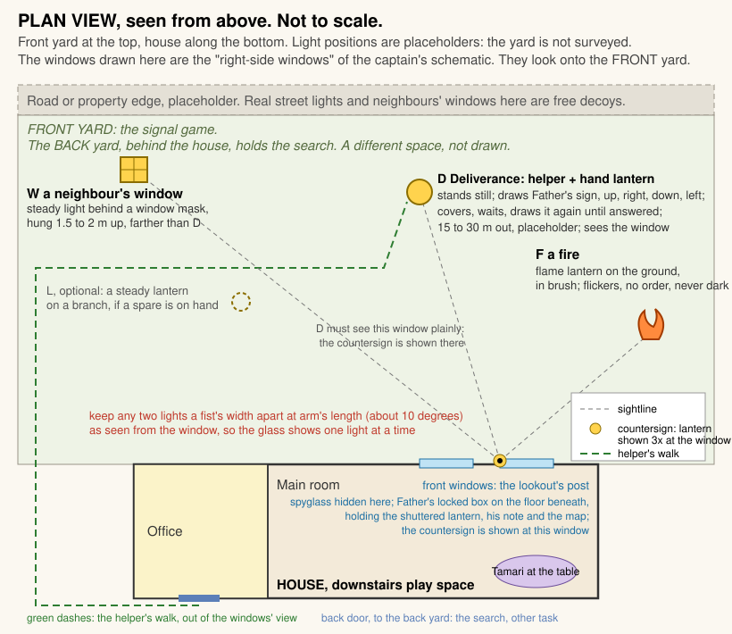
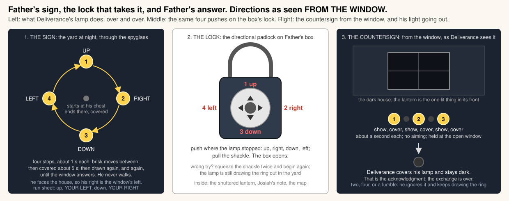

# Waitstill's lantern signal puzzle

Scout report for the Ashby Halloween escape room. Date 2026-10-17, revised the same evening. Task ashby-lantern-puzzle.

Scope: puzzle logic and a props list for Scene 2 and the hand-off into Scene 3, from Constance's reason to seek Waitstill's things to the map in the participants' hands. No electronics, wiring or outdoor light apparatus; each prop says only what it must do. The map's content and the back-yard search belong to the parallel task ashby-backyard-puzzle; here the map is a sealed object.

This is the second version. The captain rejected the first version's reply, a lantern beam aimed at the courier, on two grounds: a lantern is not a laser, and a lookout would not mirror the courier's own signal back at him. A night challenge and its reply were two different prearranged patterns. This version uses the captain's design exactly. Deliverance makes the sign that opens the box. The box holds the countersign. The countersign puts his light out. Everything the captain did not touch is unchanged from the first version.

The signal lights are in the front yard, seen from the main room's right-side windows. The drop and the search are in the back yard, behind the house. Two spaces, treated so throughout.

## Summary

- Three lights in the front yard. One is Deliverance. He is the only one making a sign: he draws a ring with his lamp, covers it, waits, and draws it again. A neighbour's window burns steadily. A fire flickers. Real street and porch lights are free decoys.
- The ring is Father's sign and the key to Father's box. Up, right, down, left as seen from the window. The box's directional padlock takes the same four pushes. No counting, no translation.
- The box holds three things: a shuttered lantern, Josiah's note, and the map. The note gives the countersign: show the lantern three times toward the yard, covering it between. That tells the courier the house is safe. It is the coast-is-clear reply the record committed.
- On the countersign Deliverance covers his lamp and does not show it again. His light going out is the acknowledgment and the end of the exchange. A wrong or muddled countersign changes nothing: he keeps drawing the ring until he gets the right one. That is the recovery.
- Why the box: the sign travels with the courier; the countersign and the drop stay locked in Josiah's box; the lookout knows none of them. Only someone who has seen a true courier's sign can learn the reply or the place. That is the family's compartment rule, and it is why the box holds a map.
- Deliverance is a helper outside with a hand lantern. Cheapest and most forgiving. If no helper exists, a built light must draw the ring, and that is a later build task.
- Target ten minutes from Constance's lead-in to the map in hand, fifteen at the outside with hints.
- Props about $90 to $150 bought, less with what the house already has. The spyglass stays plain.

## 1. The scene, as the participants live it

Constance has told them what she is waiting for. Josiah is away. He has sent word, and Deliverance is bringing it. Waitstill is at the front windows keeping watch for his brother, as he does every night his father is away, with his father's glass. He thinks his mother does not know where he hides it. She does. She tells them, and asks them to find the glass, because whoever finds Deliverance finds the message.

They go to the windows. In the hiding place she named they find a brass spyglass wrapped in cloth. On the floor under the window sits a wooden box with a lock they do not recognise and cannot open. They bring the glass to the table.

Tamari takes it, and the room hears a boy. Waitstill is whispering because he is keeping watch and it is late. He has not seen his brother yet. He tells them how a lookout knows his own. There are always lights out there, but none of them is him. A window burns all night. A fire dances. The courier comes to the edge of the land and makes a sign with his lamp, the same sign, over and over, until someone answers him. Find the one who makes a sign. Watch what his lamp does, because that is Father's sign, and Father's box takes it. Father's answer is in the box. Waitstill does not know the answer. He is not meant to, until his father's man has come.

The room goes dim. Someone opens the window and cold comes in. Out in the front yard there are lights. One is a square of warm light far off, a neighbour's window. One is low and orange and dances. One is a small light that lifts, swings, drops, swings back, and is gone. Then it is there again, doing the same thing. Through the spyglass the dancing light is a fire, and there is no order in it. The far square is a window with a cross in it. The third, through the glass, is a lantern in a man's hand. He holds it up. Out to the right. Down low. Out to the left. Then he covers it. A breath later he does it again.

The box. Its lock has a button that pushes four ways. Up, right, down, left. It opens.

Inside are a small iron lantern, shut, with a glow behind its door, a folded paper, and under them a map. The paper is in a man's hand. His sign has opened this box, so he is ours. Answer him from the window: show the lantern three times toward the yard, and cover it between. That tells him the house is safe. He will put out his light and go. The place for this carrying is marked on the map.

They take the lantern to the open window. Open it. Shut it. Open. Shut. Open. Shut. Out in the yard the ring is half drawn when the lamp is covered, and it does not come back. The window still burns. The fire still dances. The man is gone.

They have a map of a place they do not know. Constance will. And Waitstill, somewhere, is about to go out and fetch what his brother left.

## 2. The spyglass

**Where it is.** At the lookout's post: the main room's right-side windows, which look onto the front yard. It sits in a hiding place within arm's reach of the window that a boy would use and a mother would know. The exact spot depends on the real furniture, so it is a placeholder: behind the hem of the curtain, under a window-seat cushion, or in a basket or crock by the window. Only the glass is hidden there. The locked box sits on the floor beneath the window in plain sight.

**The clue, answering Q16.** Constance's lead-in at the end of Scene 1. The captain parked Constance's dialogue, so this is the content Tamari must carry, with a draft line she can replace.

- Josiah's message is coming. Deliverance carries it. Waitstill keeps watch for him.
- Waitstill watches from the front windows with his father's glass.
- She knows where he hides it, and names the hiding place.
- Find the glass. See what he saw.

Draft: "Waitstill keeps watch for his brother at the front windows, every night Josiah is away, with his father's glass. He thinks I don't know where he hides it. Behind the curtain, where he can reach it without leaving the window. Find it. Whoever finds Deliverance finds my husband's word."

The clue gives a reason, a place and a hiding spot. The search takes a minute. That is as it should be. The puzzle is at the window, not in finding the glass.

**Anything special about it.** No. Keep it a plain spyglass with real optics, 3x to 8x. I looked for a feature that would earn its place and found none that fits the story.

- A reticle or mark has no job. Nothing is measured.
- A coloured filter, or a rule scratched inside the cap, would either give away the sign before the exchange or do work Waitstill's words already do.
- A limited field is already what a spyglass has. Through a narrow glass you look at one light at a time, which is exactly the act the puzzle wants: compare what each light does.

What does earn its place is magnification itself. From 25 m a lamp moved to arm's reach swings through about three degrees. To the naked eye that is a wobble. Through a 5x glass it is a lantern at the end of an arm, stopping four times. The glass turns "which one is blinking" into "which one is drawing a shape", which is the rule Waitstill gives word for word. Buy a spyglass with glass lenses, not a toy, and test it on a yard light before the night.

## 3. The signals

### The family's practice

This is my fill, built from the record's committed outdoor outline, part 2.3 steps 1, 2 and 6, and the compartment theme in part 2.4, now carrying the captain's challenge-and-countersign design. Nothing here contradicts a committed fact.

- Before Josiah leaves he sets a sign on the lookout's box and gives the same sign to the courier he sends. He locks the countersign, the signal lantern and a map of this journey's drop inside the box. Nobody in the house knows any of the three.
- The courier never comes to the door. A courier seen entering a magistrate's house at night would end the family. He stands at the edge of the land on the road side, where a traveller's light is nothing to remark on, and makes Father's sign with his lamp, over and over, until the house answers.
- The lookout watches from the front windows with the glass. The sign opens the box. Inside is Father's answer: the countersign, and the lantern to give it with.
- The lookout shows the lantern from the window as the note says. That is "the coast is clear": the house is safe, and no one is inside who should not be. A lantern shown at a window is seen by the whole road, and that does no harm. It is a plain light, not a code, and it means nothing to anyone who has not drawn the sign a moment before.
- The courier covers his lamp and goes round to leave the message at the place Josiah marked. The lookout goes out the back and brings it in.

The captain's historical frame, which I relay and did not research further: a night challenge and its reply were two different prearranged patterns, the navy's private signals and the army's parole and countersign, while civilian signals of the period were mostly one-way, as with Revere's lanterns and the Culper clothesline. The design needs only the plausibility.

The record keeps open how Waitstill's all-clear fits Deliverance being pursued. The countersign speaks for the house, not for the road behind the courier. Nothing here fills that gap.

That is what Waitstill did that night. The participants do everything but the last step, which is Scenes 3 and 4.

### How many lights, and which is Deliverance

Three lights placed for the game, plus whatever the street already shows.

| Light | In the story | What it does | Why it is fair |
|---|---|---|---|
| D | Deliverance | A hand lantern. Uncovered at the chest, then held up, out to the window's right, down low, out to the window's left, each stop about a second, then covered for about five seconds. Repeats until answered. Does not move from his place. | The courier. The only light with an order to it. |
| W | A neighbour's window | A warm light behind a window-shaped mask, hung 1.5 to 2 m up, farther than D. Steady all night. | Waitstill says a window burns on. It is the brightest thing in the yard, so the eye goes to it first, and through the glass it is plainly a window doing nothing. The first wrong turn. |
| F | A fire | A flame-effect lantern on the ground, part-screened by brush. Flickers fast and at random, never goes dark. | "That one's blinking." It is, and through the glass it is a fire with no order in it. The better wrong turn, because it looks like signalling until you watch it. |
| L, optional | A lantern someone left burning on a barn or a branch | A plain steady lantern hung on a branch. | Only if a spare lantern is already in the house. It looks exactly like D's lamp and does nothing, which proves the rule is about what a light does, not what it is. |

Real neighbours' windows, porch lights and street lights are decoys for free and support the rule. Count them on a test night before placing anything. Watch for a porch light on a motion sensor, which goes on and off and could pass for a sign; do not put D near one.

Two decoys are enough. The record wants one principal realization per puzzle. Here it is: the courier is the one light that makes a sign and makes it again. Everything else is steady or random.

### The selection clue and where it comes from

From Waitstill's contact through the spyglass. The exact text is in section 4. The rule in one line: a window burns, a fire dances; he makes a sign with his lamp, the same sign, again and again, until someone answers.

### Plan view

Placement rules the figure carries:

- Every light visible from the window the participants will use, with the room dark or the sash open.
- Any two lights about a fist's width apart at arm's length as seen from the window, which is about ten degrees, so the glass holds one light at a time.
- D 15 to 30 m out, where he can see the window plainly. The countersign is a lantern shown at that window, and he must see it without moving.
- Decoys at the same distance or farther.
- The helper's walk to D leaves by a door the front windows cannot see.
- The helper's route and spot stay clear of the swamp the record places on the property.
- The main room dark enough to see the yard, and dark enough that the shown lantern is the one lit thing in the front of the house. Lighting cues directing attention is a committed principle; here the cue is darkness at the window and a candle at the table.

## 4. The code

### Deliverance's sign: the ring

Deliverance's sign is a ring drawn with his lamp, four stops, as seen from the window: UP, RIGHT, DOWN, LEFT. He uncovers the lamp at his chest, lifts it high, swings it out to the window's right, drops it low, swings it out to the window's left, brings it back to his chest and covers it. Each stop is held about a second, and the moves between are brisk, so what the glass sees is four places the light stops, not a smooth circle. He waits about five seconds covered and draws it again. He keeps this up, a cycle every ten or twelve seconds, until the window answers. He never walks.

He faces the house, so his right is the window's left. The run sheet tells him: up, YOUR LEFT, down, YOUR RIGHT.

### Why the ring stays, and why a directional padlock

The captain allowed either the ring with the directional padlock or a show-and-cover count that maps onto the lock. The ring stays, for four reasons.

- It maps onto the lock with nothing in between. The lamp stops in four places; the lock's button pushes four ways; push it where the lamp stopped. A count would need a lock that takes a number, and a number has to be counted, remembered and turned into something else. The record forbids assuming a flash-count system, and a count is the thing a nervous group miscounts.
- It is unmistakably deliberate. The selection clue is now "the one who makes a sign". A light carried round four stops is a sign to anyone watching. A light that goes on and off could be a fire, a passing lamp or a porch light on a sensor. The ring does the selection work and the key work in one gesture.
- It is the right kind of thing for a courier to hold in his head and draw in the dark at 25 m with one arm, and for Josiah to change between journeys.
- Four moves is the shortest sequence that draws a shape. Nothing shorter is a shape.

### How the sign becomes the key

The box's lock is a directional padlock. It has one button that pushes up, down, left and right, and it opens on a set sequence of pushes. The sequence is the ring. The exact code: **Up, Right, Down, Left**, from the window's point of view, and the same four pushes on the lock. Set the lock to this and do not leave the factory sequence.

The lamp's first stop after it is uncovered is UP, so the sequence has an obvious start. A group that pushes the four in the wrong order squeezes the shackle twice and begins again. The lamp is still drawing the ring out in the yard, and they can watch it once more.

### The countersign: Father's answer

Inside the box, on top of the map, lie a shuttered lantern with a light inside and a folded note in Josiah's hand. The note is the countersign. Exact text:

> For the one who keeps the window.
>
> His sign has opened this box, so he is ours. Answer him from the window: show the lantern three times toward the yard, and cover it between. That tells him the house is safe. He will put out his light and go.
>
> The place for this carrying is marked on the map. Nothing else is to pass between you.

The reply control is the shuttered lantern: a hand lantern whose light is hidden until a shutter or door is opened. The participants hold it at the open window, or against the glass if the sash does not open, and open and shut it three times. No aiming. The room is dark, so the lantern is the one lit thing in the front of the house, and the helper sees it from his spot without moving.

Why three. One show is an accident, a candle carried past a window. Two could be a door opened and closed. Three is plainly meant, and still short enough that nobody counts on their fingers. It is also a different kind of thing from the ring, a count and not a shape, so neither party echoes the other, which is how a challenge and its reply were kept apart.

What the countersign means: the coast is clear. The record committed that meaning for the participants' reply, and the note says it in Josiah's words: the house is safe.

### Deliverance's acknowledgment, and the recovery

On three clean shows Deliverance covers his lamp, wherever he is in the ring, and does not show it again. He stays at his spot, dark, until the host collects him. His light going out is the acknowledgment the record kept from CP03, and the end of the exchange. It comes after the box is open, so it replaces neither the combination nor the map, which is the limit CP05 put on it. The window still burns and the fire still dances, because a window and a fire answer nobody; that contrast is the confirmation.

On anything but three clean shows, two, four or a fumbled door, he does nothing different. He keeps drawing the ring. There is no failure state to recover from: a group that loses count or looks away has the sign out in the yard whenever they look again, and gives the countersign when they are ready. A countersign given before the box is open cannot happen, because the lantern is in the box.

### The exact clue text

Waitstill, through the spyglass, performed by Tamari. His text, not Constance's, so it is not parked. Tamari may put it in her own voice. The facts inside it must stay, and nothing may be added: the sign, the countersign and the place are the box's to give.

> Hush. Is it late? He should have come by now. Deliverance. Father sent him with word, and I'm to watch for him from the front windows and not leave them. You watch for me.
>
> There are always lights out there. A window burns all night. A fire dances. None of that is him. He comes to the edge of the land and makes a sign with his lamp, the same sign, over and over, until someone answers him. Find the one who makes a sign.
>
> Watch what his lamp does. That's Father's sign, and Father's box takes it.
>
> Father's answer is in the box. I don't know it. I'm not to, till his man has come.

Each thing the participants need is in it or follows from it: where to look, how to know him, that his sign is the key to the box, and that the answer is in the box. What Waitstill does not say: the sign itself, the countersign, how the lock is pushed, where the message is, anything about the yard behind the house, anything about his death.

## 5. The chest

**Where.** On the floor at the lookout's post, beneath the front windows, in plain sight beside the hiding place. Participants will try it before the exchange and fail. That is fine, and the four-way button on the lock is a small invitation to notice the shape of the sign later.

**What it is.** A small wooden chest with a lid and a hasp. Interior at least 32 by 22 by 22 cm. It must take, together: a shuttered hand lantern up to 20 cm tall, standing or lying; the map folded flat to 24 by 17 cm, which is a letter sheet folded once, or a roll up to 30 cm long and 5 cm across; and a folded note. The back-yard task should keep the map inside one of those two envelopes.

**The lock.** A Master Lock 1500iD directional padlock, or an equivalent that opens on a sequence of up, down, left and right pushes. Master Lock's own instructions say the sequence can be any length in any order, is reset with a lever on the back, and is cleared by squeezing the shackle twice before each attempt. Set it to up, right, down, left.

**How it opens.** Press the shackle down twice, push the button up, right, down, left, pull the shackle. Open the lid. Lantern, note, map.

**Reset in under a minute.** Shut the lantern and check its light is still on. Fold the note and the map. Lantern in, note on top, map beneath or beside. Close the lid, hook the padlock through the hasp, squeeze it shut. About twenty seconds. For the whole post: the spyglass back in the hiding place, the decoys on, and the helper back at his spot, ready to draw the ring when the room goes dark. Under a minute.

**Why the lantern is in the box.** This is a change from the first version, and my call. Three reasons. The lantern is half of Father's answer, and keeping the means of replying under the same lock as the reply is what a compartment is. It makes "Father's answer is in the box" literally true. And it removes the one way the puzzle could break: a group fiddling with a lantern at the window before the box is open might show it three times by accident and put Deliverance's light out before they had read his sign. With the lantern locked up, the countersign cannot be given before the sign has been read. The alternative, lantern hidden with the glass, works if the box must stay small, but then the helper needs a rule for an early countersign, and I have none I like.

**Why the box holds a map, and why Deliverance's sign opens it, answering Q14.** Inside the family's practice from section 3, which is my fill on the captain's design. The sign travels with the courier. The countersign and the place for this message stay locked in Josiah's box. The lookout holds none of them in his head. A search of the house finds a box nobody inside can open. A question put to anyone inside gets nothing, because they do not know. Only on a night when a true courier stands in the yard and draws the sign does anyone in the house learn how to answer him or where he will leave what he carries. The countersign sealed in the box is the compartment rule: only someone who has seen the courier's sign can learn the reply. The map is the other half of the same rule. The drop changes with the journey, so the place has to be written down somewhere, and the box is the one place in the house a search cannot read.

That is also why it is a map and not a word. Waitstill knew every tree, rock and wall on the property. The map gave him no navigation problem. It told him which of the family's places was in use tonight, and that closes the record's gap about a map carrying his retrieval. The participants, who do not know the property, get the search he never needed.

A lighter alternative, if the captain wants one fixed drop: the box holds the family's record of the drop under Josiah's lock so that a search of the house finds nothing anyone inside can open. The puzzle is unchanged. Constance recognizes the wall and the hollow either way.

On this night, in my reading, the compartment is also part of what killed the family. The courier could not come to the door, so a boy had to go out.

In the haunting's presentation the chest is simply where Waitstill left everything when he went out. The participants take his place, repeat his night, and the box gives them what it gave him.

## 6. The map-return order, answering Q17

The order does not shift. Recommended order, with the reason. A script outline for Tamari, not dialogue.

1. **Return and report the exchange.** The participants bring the map to the table. Constance is still present. They tell her: Deliverance came and made his sign, the box opened, Father's answer was given, and his light went out. Constance brightens. Her husband's man has come, the message is at hand, Waitstill will fetch it. She asks to see what the box held.
2. **Waitstill's fragment, through the map.** Tamari takes the map. The contact shifts to Waitstill, as it did with the spyglass. Short, in his voice: the box opened, he knows the place, he goes out the back, across the yard toward the wall. Lanterns, voices, soldiers. He is caught. He does not come back. The fragment ends without describing his death in detail. If the bird call stays in, this is where it is first heard: a whistled call cut short, nothing to decode, the call Mindwell will later know as his warning.
3. **The report of the first death.** Tamari surfaces. Constance returns and does not know what was heard. The participants tell her: Waitstill went out for the message and the soldiers killed him. The first death. Grief and disbelief first, then the woman who ran this network: if he never reached it, it is still there.
4. **The map interpretation and the task.** Constance looks at the map through Tamari. She knows the old property, the great tree, the boulder, the wall and the hollow in it. She explains the hiding place. The task is now hers to give: use the map, go out the back, find the place, bring back what Josiah sent.

Why this order. The map's first touch should summon its last user, the way the spyglass did, so the object-contact model stays consistent. The death should land before the task, so that Constance's explanation of the wall is charged by it and the participants go out carrying it. And Constance must learn the death from the participants, never from the object, which is the committed knowledge discipline. Interpreting the map before the fragment would hand the participants a task and then stall it with a death. This way the death is the reason to go.

One hand-off note for the back-yard task. Nothing in the box tells the participants to go outside. Josiah's note says the place is marked on the map and no more, and the map should show an old property whose landmarks the participants cannot place from the window. That is why they bring it to the table. Keep the map an old plan, not a modern yard sketch with an X that anyone could follow without Constance.

Timing: four to five minutes at the table.

## 7. Hint ladder and target time

Target: ten minutes from Constance's lead-in to the map in hand. Fifteen is the ceiling. Hints are triggered by what the group does; if the clock passes twelve minutes with no map, Tamari moves down the ladder regardless.

Why. This is the first real puzzle of nine scenes, and it teaches the rhythm every later scene reuses: object, contact, task at a station, discovery, return. It should feel solved, not survived. The night also has an outdoor segment and a room change that eat time, so the early scenes must run tight. The countersign adds about a minute to the first version's estimate and the target absorbs it.

Hints, from Tamari at the table, in Waitstill's voice:

1. **No choice after two minutes at the window.** "Don't look at how bright they are. Look at what each one does. Hold the glass on one at a time."
2. **Still no choice, or arguing over the fire.** "A window doesn't move. A fire dances, but there's no order in it. His lamp does the same thing every time, then it waits, then it does it again."
3. **Found him, stuck at the box.** "Father's box takes his sign. Where his lamp stops, push the lock that way. Up first, then where he goes next. If it's wrong, press it shut twice and start over."
4. **Box open, no countersign, or his light has not gone out.** "Father's answer is in the box. Read it, and do what it says at the window, where he can see you." Only if they still fail: "Three. Shut it between."

A fifth, only if the glass itself is not found: Constance, not Waitstill, repeating the hiding place.

## 8. Props list

No electronics design. Each line says what the prop must do, whether it is on hand, bought or built, and a rough cost. "On hand" is my guess at a household; the captain corrects it.

| Prop | What it must do | On hand, buy or build | Rough cost |
|---|---|---|---|
| Spyglass | Plain, brass look, real glass optics, 3x to 8x, usable one-handed at a window. Must resolve a lantern and the arm that moves it at 25 m. | Buy, or on hand | $15 to $35 |
| The shuttered lantern, the reply control | Hide its light when shut, inside the closed box too; show it plainly at 30 m when open; be opened and shut three times in a few seconds by someone who has never held it; fit in the box; look like a hand lantern of the period. No beam. Any shuttered or dark lantern with a light inside. Build from a metal candle lantern with a hinged door, the other panes blacked inside, and a flameless candle that stays on all evening; or buy a reproduction dark lantern. | Build, or buy | $10 to $15 built, $25 to $50 bought |
| Deliverance's lantern | Warm hand lantern the helper can hold out at arm's reach, cover with a cloth or a coat flap, and uncover; visible at 30 m. | On hand or buy | $0 to $15 |
| Josiah's note | The exact text in section 4 on a half sheet, folded, laid on top of the map. | Print; tea-stain if wanted | $0 |
| Window decoy W | Steady warm light behind a window-shaped mask with a cross muntin and a translucent panel; hangs 1.5 to 2 m up; survives one night outdoors. | Build from scrap plus a battery lantern | $10 |
| Fire decoy F | Flame-effect lantern or flicker light on the ground, screened by brush so only the glow shows. | Buy | $12 to $15 |
| Optional decoy L | Plain steady lantern hung on a branch. | On hand only | $0 |
| The box | Wooden chest with lid and hasp, interior at least 32 by 22 by 22 cm; takes the lantern, the note and the map together; lid opens freely; hasp takes a padlock shackle. | On hand or buy | $20 to $40 |
| The lock | Directional padlock that opens on a sequence of up, down, left and right pushes, resettable. Master Lock 1500iD or equivalent. Set to up, right, down, left. | Buy | $15 to $30 |
| Hiding-place dressing | Cloth to wrap the glass; whatever makes the window-side spot a plausible boy's hiding place. | On hand | $0 |
| Hangers and stakes | Hooks, cord or stakes to hang W and F, and a marker the helper can find in the dark for D's spot. | On hand | $0 to $5 |
| Helper's run sheet | One page: start drawing the ring when the main room goes dark; the ring with the mirror note; a second a stop, five seconds covered, repeat; wait for three clean shows at the window; then cover the lamp and stay dark; ignore anything else. The figure in section 4 serves. | Print | $0 |
| Room darkening | A way to make the main room dark enough to see the yard, or to open a sash. A candle at the table. | On hand | $0 |
| Helper's own light | Headlamp for the walk out and back, off at the spot. | On hand | $0 |

Total bought: about $90 to $150. With a spyglass, a chest and lanterns already in the house, about $35 to $55 for the lock, the fire light and the lantern parts.

Not in this list: the map, owned by the back-yard task, and any device that draws a ring or switches lights from inside, which exists only in the no-helper fallback in question 1 below.

## 9. Open questions

Numbered, one per line, self-contained, each with my default. Most calls above are mine and stated. These are the ones that belong to the captain or change the build.

1. Is a helper available to play Deliverance outside for about ten minutes, standing at a marked spot with a hand lantern? Default: yes, the host does it, leaving by a door the front windows cannot see while Tamari runs the table. If no, the fallback is a built light at D that draws the ring on its own and goes dark on a cue from inside, and that is a build task I have not designed.
2. Do the front windows open, and is there a screen? Default: open one sash for the exchange, because the view is better without reflections and the shown lantern is plainer from the yard. If not, darken the room fully and hold the lantern against the glass.
3. Where exactly is the lookout's hiding place for the glass? It depends on the real furniture at the front windows. Default: behind the curtain hem, with the box on the floor beneath.
4. Does Josiah's hiding place change per journey, so the box tells the lookout the place for this message, or is there one fixed drop? Default: it changes. It makes the box necessary and reads as the family's compartment. The puzzle and Constance's recognition of the wall are the same either way; only the map's framing wording moves, and the back-yard task should know which.
5. Constance's lines in section 2 are drafts, because the captain parked her dialogue. Default: Tamari carries the four facts in her own words.
6. The sign is a ring, up, right, down, left, and the countersign is three shows of the lantern. Default: keep both. Any other four-stop shape works for the sign if the helper mirrors left and right; two shows is too easy to do by accident and four starts to need counting.
7. Does the bird call stay in, heard first at the end of Waitstill's map fragment and again in Mindwell's scene? Default: keep it, as a cut-short whistle with nothing to decode.
8. Two decoys or three? Default: two, the window and the fire. Add the hung lantern only if a spare is already in the house.
9. When Deliverance goes dark on the countersign, do the decoy lights go dark too? Default: no, only his lamp, because a window and a fire answer nobody and the contrast is the confirmation. A whole yard going dark needs lights the host can switch from inside, which is a build item.
10. If participants carry Josiah's note to the table expecting a contact, what does Tamari do? Default: nothing supernatural, because Josiah is not in this house. Constance, through Tamari, knows the hand as her husband's and sends them back to the window to do what it says. A line for the captain and his partner, since Constance's dialogue is parked.

## Method and evidence

This task was relaunched to revise the first version. I read the first version in this directory, firstmate's revision note carrying the captain's design and his two objections, and then, in the order the original brief set, design-record.md with part 1 Scenes 1 to 3, parts 2.3 and 2.4, parts 3.1 to 3.4, part 4 and the open questions as the governing text; report.md part 5 for Q13, Q14, Q16, Q17 and Q18; and decisions.md including the lantern-exchange ruling of 2026-10-17. I did not open the five raw checkpoint files. The front-yard clarification from the first pass is applied throughout, and its message is acknowledged in the task inbox.

What changed from the first version: section 1, the scene; section 3, the family's practice and the selection clue, now "the one who makes a sign"; section 4, rewritten around the ring as the key, Josiah's note as the countersign, and the light going out as the acknowledgment; section 5, the lantern moved into the box, the box enlarged, and the compartment answer to Q14 restated on the captain's rule; section 6, the report in step 1 and a hand-off note; section 7, hints 2 to 4; section 8, the lantern, the note, the box and the run sheet; section 9, questions 6, 9 and 10. What did not change: the spyglass and its clue, the three lights and their fairness, the placement rules except the angle, the lock and its sequence, the map-return order, the target time.

Facts checked outside the record, carried from the first version:

- Master Lock 1500iD: the combination can be any number of directional moves in any order; reset uses a lever on the back; clear with two squeezes of the shackle before each opening. Source: Master Lock's instruction page, https://www.masterlock.com/support/instructions/Speed_Dial_1500iD_Instructions. Marketplace prices seen were about $15 to $40 for one lock; no official list price found.
- Dark lantern: a candle lantern with a sliding shutter so the light can be hidden without putting out the flame, in use in the eighteenth century; museum examples tie the type to night watchmen and later police. Sources: https://en.wikipedia.org/wiki/Lantern and https://ctcollections.org/index.php/Detail/objects/31260. I found no source tying dark lanterns to spies, so the report claims only that a lookout's family could own one.
- The captain's historical frame for two different patterns, the navy's private signals, the army's parole and countersign, Revere and the Culper clothesline, is relayed as his and was not re-verified. Nothing in the design depends on it beyond plausibility.

Figures: plan-view.svg, revised to remove the aimed beam, show the countersign at the window and list the box's contents; the-ring.svg, revised to show the four stops, the repeat cycle and a third panel for the countersign and the light going out. Both are hand-drawn SVG in this directory and both parse.

Interpretations, all marked in the text: the family's practice in section 3; the lantern locked in the box; three shows as the countersign; Josiah setting the box's sign; the per-journey hiding place; the hiding-spot placeholders; the yard distances; only Deliverance's light going out; Josiah's note not being a contact object.

Nothing in this report proposes a change to code or to any project. There is nothing to ship.
